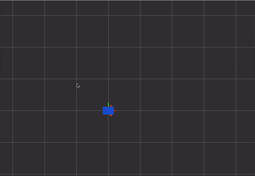
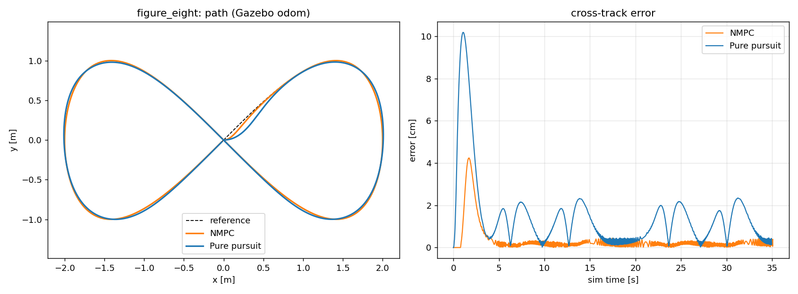
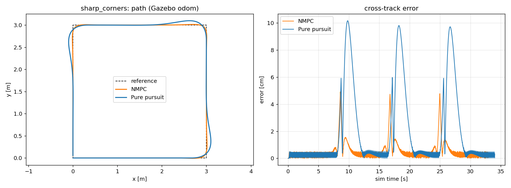
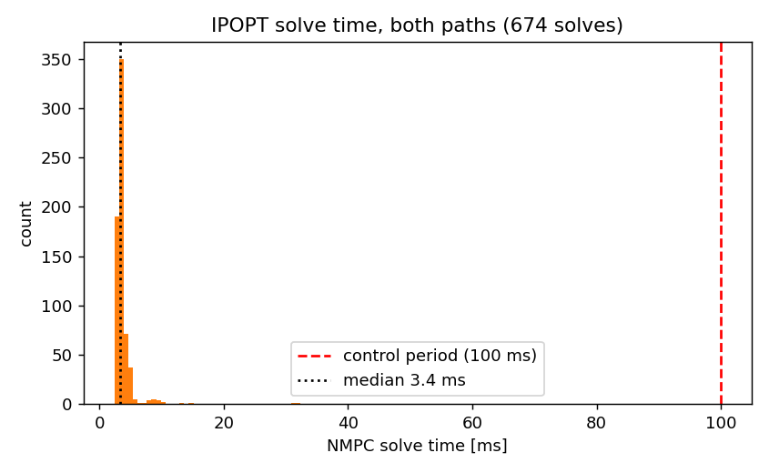
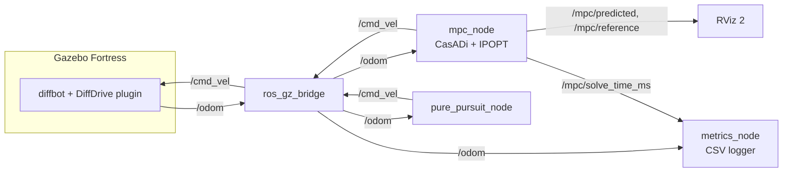

# ros2-nmpc-diffdrive

Nonlinear MPC path tracking for a differential-drive robot, written with CasADi + IPOPT,
running in ROS 2 Humble with Gazebo Fortress. I also wrote a pure pursuit controller on the
same paths so I had something honest to compare against.



*RViz during a real Gazebo run. Grey = reference path, orange = what the MPC thinks the robot
will do over the next 2 s, blue box = the robot.*

## Why I did this

All my earlier projects used PID or pure pursuit for following a path. They work, but they
only look at where the robot is right now. I wanted to actually understand MPC instead of just
knowing the name, so I built one from the kinematic model up and put it next to pure pursuit
on two paths: a figure eight (smooth but constantly changing curvature) and a 3 m square
(90 degree corners, which is where pure pursuit usually struggles).

## Results

All numbers below come from the CSVs in `results/`, logged from Gazebo `/odom` during the runs.
Each run is one lap at 0.35 m/s, fresh Gazebo instance every time.

| Path | Controller | CTE RMSE [cm] | CTE max [cm] | Lap time [s] | Solve median [ms] | Solve p95 [ms] | Solve max [ms] |
|---|---|---|---|---|---|---|---|
| figure_eight | NMPC | 0.73 | 4.24 | 35.1 | 3.33 | 4.66 | 32.37 |
| figure_eight | Pure pursuit | 2.31 | 10.18 | 35.0 | - | - | - |
| sharp_corners | NMPC | 0.90 | 4.91 | 33.0 | 3.40 | 5.33 | 30.95 |
| sharp_corners | Pure pursuit | 3.46 | 10.16 | 34.0 | - | - | - |

CPU: Intel Xeon (8 threads, cloud VM, model not reported by `/proc/cpuinfo`), N=20, dt=0.1 s.
CTE = cross-track error, distance from the robot to the closest point on the path.

So on these runs NMPC had about 3-4x lower RMSE and about half the worst-case error, and the
solver used roughly 3-5 ms out of the 100 ms control period.





A few things worth saying about these numbers:

- The worst error for both controllers on the figure eight is right at the start. The robot
  spawns facing +x but the path starts at 45 degrees, so both have to swing round first.
- On the square, the NMPC spikes (~4-5 cm) are at the corners too. It starts turning a bit
  before the corner because it can see it coming in the horizon, so it cuts in slightly instead
  of overshooting. Pure pursuit overshoots by ~10 cm after every corner.
- The flat ~0.4 cm "floor" in the error plots is mostly my measurement, not the robot. The path
  is stored as points about 1 cm apart and I take distance to the nearest point, so there's
  some quantization noise. I left it in rather than hide it.
- Solve max of ~30 ms is the first solve (cold start, no warm start yet). Later solves are warm
  started from the shifted previous solution.
- Pure pursuit lookahead is 0.4 m. I didn't tune it much, so a better tuned pure pursuit would
  close some of the gap. That's a fair criticism of this comparison.
- Only one lap per case, no noise added in Gazebo, ideal odometry from the diff drive plugin.
  So this is a clean-sim comparison, not a real robot.

## How it works

The robot is modelled as a unicycle:

```
x' = v cos(theta)
y' = v sin(theta)
theta' = omega
```

Every 100 ms the controller solves this problem over N = 20 steps (2 s ahead):

```
min  sum_k  |x_k - xref_k|_Q^2 + |u_k - uref_k|_R^2 + |u_k - u_(k-1)|_Rd^2   +  |x_N - xref_N|_P^2
s.t. x_(k+1) = RK4(x_k, u_k, dt)
     -0.1 <= v <= 0.5 m/s,  |omega| <= 1.5 rad/s
     |dv| <= 1.0 m/s^2 * dt,  |d omega| <= 3.0 rad/s^2 * dt
```

Then it applies only the first (v, omega), and does it all again with the new odometry.

Some details:

- **Multiple shooting.** Both states and inputs are decision variables and the dynamics are
  equality constraints. I tried to understand why people prefer this over single shooting:
  basically errors don't blow up through 20 nested RK4 steps, so IPOPT converges more easily.
- **Reference sampling.** The path is just geometry. `HorizonSampler` finds the closest point
  (only searching forward, otherwise on the figure eight it jumps to the other lobe at the
  crossing) and then picks N+1 points spaced v_ref*dt apart. Feed-forward omega comes from
  the heading change between those points.
- **Angle wrapping.** Reference headings are unwrapped relative to the robot heading, otherwise
  going past +-pi makes the theta error suddenly ~6 rad and the robot spins.
- **Warm start.** Previous solution shifted by one step is the initial guess.
- **If IPOPT fails** the node halves the previous command instead of using a half-solved plan.
  It never actually failed in these runs, but I wanted something sane there.

## Architecture



Only one of `mpc_node` / `pure_pursuit_node` runs at a time. `metrics_node` stops by itself at
the end of the lap and the launch file shuts the rest down, so runs are scriptable.

## Repo layout

```
mpc_diffdrive/
  mpc_solver.py         NMPC itself, no ROS imports (so it can be tested alone)
  reference.py          paths, horizon sampler, cross-track error
  mpc_node.py           ROS 2 node
  pure_pursuit_node.py  baseline
  metrics_node.py       CSV logger, ends the run after one lap
launch/sim.launch.py    Gazebo + bridge + robot_state_publisher + RViz
launch/track.launch.py  controller + logger
tools/offline_sim.py    ROS-free closed loop, I used this for tuning
tools/analyze.py        CSVs -> plots + metrics table
docker/                 Dockerfile + scripts I used to run everything headless
results/                the CSVs behind the table above
test/                   pytest
```

## Running it

### Native (Ubuntu 22.04 + ROS 2 Humble)

```bash
sudo apt install ros-humble-ros-gz ros-humble-xacro ros-humble-robot-state-publisher
pip3 install casadi
mkdir -p ~/ws/src && cd ~/ws/src
git clone https://github.com/Shannu2555/ros2-nmpc-diffdrive.git mpc_diffdrive
cd ~/ws && colcon build --symlink-install && source install/setup.bash

# terminal 1
ros2 launch mpc_diffdrive sim.launch.py
# terminal 2
ros2 launch mpc_diffdrive track.launch.py controller:=mpc path:=figure_eight out_dir:=$HOME/mpc_logs
# or controller:=pure_pursuit, path:=sharp_corners
```

Restart the sim between runs, the robot needs to start from the origin again.
Then `python3 tools/analyze.py ~/mpc_logs ~/mpc_logs/plots`.

### Docker (what I actually used for the results)

```bash
./docker/run_all.sh ./runs
```

This builds the image, runs all four combinations headless (Gazebo server only, RViz on a
virtual display recorded with ffmpeg) and writes CSVs, logs, mp4s and plots into `./runs`.

### Without ROS

```bash
pip3 install casadi numpy matplotlib pytest
python3 tools/offline_sim.py --path figure_eight --plot
python3 -m pytest test
```

## What was hard / what broke

- **Getting ROS onto my machine at all.** The box I ran this on wasn't Ubuntu, so I went with
  Docker. Then `apt` inside the official ROS image kept timing out on `packages.ros.org` from my
  network. Fixed it by pointing apt at the OSU mirror of the same repo and re-fetching the
  ROS signing key (see `docker/Dockerfile`).
- **The shutdown crash.** `mpc_node` tried to publish a zero `Twist` after ctrl-c, but by then
  the rclpy context was gone so it threw `publisher's context is invalid` and the launch
  reported the node as died. Now it checks `rclpy.ok()` first.
- **Knowing when a run is "done".** First version of the logger just logged forever and I was
  cutting the CSVs by hand. Now it tracks progress along the path and exits after one lap.
  The figure eight and the square both start and end at the origin, so "close to the end
  point" alone was not enough; it also has to have gone through almost all the path indices.
- **The figure-eight crossing.** Nearest-point search over the whole path makes the sampler
  jump to the other lobe at the crossing point. Restricting the search to a forward window
  fixed it.
- **RViz recording.** My first recordings were useless: 200 odometry arrows covered everything
  and the view was zoomed into one corner. Changed the odometry display to a single small axes
  marker and fixed the top-down camera.
- **Not tested on real hardware.** Everything here is simulation. On a real robot I'd expect
  wheel slip, odom drift and a delay in `/cmd_vel` to matter a lot more than they do here.

## Next

Porting the solver to C++ as a Nav2 controller plugin, and adding a noise/latency test so the
comparison isn't only on perfect odometry.

## License

MIT
